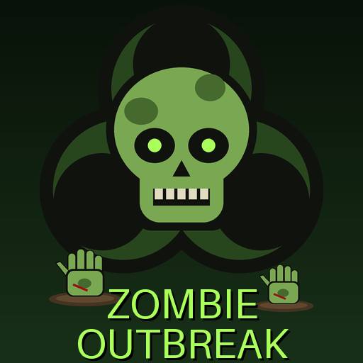

# Zombie Outbreak – a Hearts of Iron IV mod

Raise the dead and send them to the front. This mod adds **zombie battalions you
research and train like any other unit**: a new **Necrotech** research tab, a
new **Reanimation Serum** equipment line that you produce in military
factories, and three new battalions for the division designer.



## What it adds

### Units (division designer)

| Battalion | Type | Manpower | Training | HP | Org | Needs | Role |
|---|---|---|---|---|---|---|---|
| **Zombie Horde** | Line infantry | 600 | 60 days | 30 | 45 | 100 serum | Cheap, fast to raise, strong soft attack and breakthrough, weak defense |
| **Zombie Brutes** | Line infantry | 400 | 120 days | 25 | 35 | 150 serum | +30% soft attack, +50% breakthrough, −25% defense, −15% speed |
| **Infected Hounds** | Support company | 100 | 60 days | 2 | 20 | 20 serum | Recon company (+1 recon, better movement in forest/jungle/marsh/hills) |

For comparison, vanilla infantry costs 1000 manpower and takes 90 days to train.
All zombie units have high morale (0.5, so they regain organisation quickly)
but low suppression (0.5), so they are poor garrison troops. Hordes fight
better in cities, forests and jungles, brutes in cities, and both fight worse
in mountains.

### Equipment (production)

| Equipment | Year | Soft atk | Hard atk | Piercing | Defense | Breakthrough | Speed | Cost (IC) | Resources |
|---|---|---|---|---|---|---|---|---|---|
| Reanimation Serum I | 1936 | 7 | 0.5 | 1 | 15 | 6 | 3.5 | 0.35 | 1 steel |
| Reanimation Serum II | 1938 | 10 | 0.8 | 1.5 | 19 | 8 | 3.5 | 0.45 | 1 steel |
| Reanimation Serum III | 1942 | 14 | 1.2 | 2 | 24 | 11 | 4 | 0.55 | 1 steel, 1 chromium |

(Vanilla Infantry Equipment I: 6 / 1 / 4 / 22 / 3, speed 4.) Serum is weak
against tanks: build anti-tank support for zombie divisions.

### Research: the Necrotech tab

```
1936                     Reanimation Experiments  ── unlocks Zombie Horde + Serum I
                 ┌───────────────┼────────────────┐
1938      Virulent Strain   Stabilised Serum   Infected Hounds  ── unlocks hounds
          +10% atk/brk         Serum II              │
                 │               │                   │
1940      Necrotic Brutes   Relentless Hunger   Pack Hunters
          unlocks brutes     +5 org, +morale    +1 recon, +20% atk, +10% speed
                 │               │
1942       Bone Plating      Perfected Serum
          +def for zombies      Serum III
                                 │
1944                        Apex Strain  ── +15% atk, +10% brk, +10 org, +10% speed
```

## Installing

Hearts of Iron IV only shows a technology in the research screen if its tab
exists in the game's `interface/countrytechtreeview.gui`. That file belongs to
the base game and changes with every patch, so the mod can't ship a copy of it.
Instead, the installer reads the file from **your** game install and adds the
Necrotech tab to a copy inside the mod.

### Option A: installer script (recommended)

You need [Python 3.8 or newer](https://www.python.org/downloads/). No other packages are required.

1. Download this repository (green **Code** button → **Download ZIP**) and unzip it.
2. Open a terminal in the unzipped folder and run:
   ```
   python tools/install.py
   ```
   On Windows you can use `py tools/install.py`. The script finds your Steam
   install and your `Documents/Paradox Interactive/Hearts of Iron IV` folder,
   copies the mod into its `mod` folder and adds the research tab.
   If it can't find the game (for example a GOG, Microsoft Store or non-default
   Steam library), tell it where the game is:
   ```
   python tools/install.py --game-dir "D:/SteamLibrary/steamapps/common/Hearts of Iron IV"
   ```
   `--user-dir` does the same for the Documents folder, and `--tab-x` sets the
   tab's pixel position if it overlaps another tab.
3. Start the Paradox launcher, add **Zombie Outbreak** to your playset and play.

**Run the script again after every HoI4 update**, so the tech screen matches the new game version.

### Option B: by hand

1. Copy the `zombie_outbreak` folder and `zombie_outbreak.mod` into
   `Documents/Paradox Interactive/Hearts of Iron IV/mod/`.
2. Copy `<HoI4 install>/interface/countrytechtreeview.gui` into
   `mod/zombie_outbreak/interface/`.
3. In that copy, search for `name = "folder_tabs"`. Paste the contents of
   [`tools/snippets/zombie_folder.gui`](tools/snippets/zombie_folder.gui) on a
   new line directly **above** the `containerWindowType = {` line that opens
   the `folder_tabs` window.
4. Still in the `folder_tabs` window, paste
   [`tools/snippets/zombie_folder_tab.gui`](tools/snippets/zombie_folder_tab.gui)
   just before that window's closing `}`. Replace `{TAB_X}` with the largest
   `x` used by the other `..._folder_tab` buttons plus 80.

## Playing with zombies

1. Open **Research**, then the **Necrotech** tab, and research **Reanimation Experiments**.
2. In **Production**, add a line for **Reanimation Serum I**.
3. In the **Division Designer**, build a template using **Zombie Horde**
   battalions. Add **Infected Hounds** as a support company once researched.
4. Train it from the **Deployment** screen like any other division.

To try it out quickly, open the console (`` ` `` or `~`) and type
`research zombie_reanimation`, or `research all`.

## Known limitations

- **The AI doesn't use zombies.** It has no division templates for them, so
  the techs are set never to be picked by the AI. Zombies are a player-only weapon.
- Zombies reuse the infantry 3D models and map counters. Only the 2D icons are new.
- English text only. Other game languages show the English names.
- The mod conflicts with other mods that also replace
  `interface/countrytechtreeview.gui`, for example big tech-tree overhauls.
- The mod hasn't been play-tested in a live game yet. If something doesn't
  show up, check `Documents/Paradox Interactive/Hearts of Iron IV/logs/error.log`
  for lines that mention `zombie` and open an issue with them.

## Repository layout

```
zombie_outbreak.mod                  launcher file for a manual install
zombie_outbreak/                     the mod itself
  descriptor.mod, thumbnail.png
  common/technology_tags/            "zombie_tech" research category + "zombie_folder" tab
  common/technologies/               the 10 Necrotech technologies
  common/units/                      Zombie Horde, Zombie Brutes, Infected Hounds
  common/units/equipment/            Reanimation Serum I–III
  interface/                         sprites (.gfx) and tech-item templates (.gui)
  gfx/                               icons (generated, see below)
  localisation/english/              names and descriptions
tools/
  install.py                         installer + tech-screen patcher
  snippets/                          the GUI blocks the installer inserts
  validate.py                        static checks for the whole mod
  generate_art.py                    redraws every icon (needs Pillow)
  clausewitz.py                      small parser for Paradox script files
```

## Development

```
python tools/validate.py        # checks techs, units, equipment, localisation, sprites, textures
pip install pillow
python tools/generate_art.py    # regenerate all icons after editing the drawings
```
